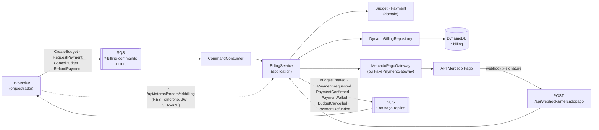

# Billing Service — Orçamento e Pagamento (Fase 4)

Microsserviço de **orçamento e pagamento** da oficina mecânica (Tech Challenge SOAT/FIAP),
integrado ao **Mercado Pago** ([documentação](https://www.mercadopago.com.br/developers/pt)).
É um **participante da saga orquestrada** pelo
[os-service](https://github.com/arodri19/soat-fiap-oficina-mecanica-os-service) —
arquitetura geral, diagramas e justificativa da saga em
[os-service/docs/arquitetura.md](https://github.com/arodri19/soat-fiap-oficina-mecanica-os-service/blob/fase04/docs/arquitetura.md).

## Responsabilidades

- **Geração do orçamento** a partir dos itens/preços enviados na abertura da OS e envio para aprovação
- **Registro e verificação de pagamentos**: preferência no Mercado Pago Checkout Pro, webhook
  com validação de assinatura, consulta do pagamento na API
- **Atualização do status da OS após o pagamento**: publica `PaymentConfirmed` / `PaymentFailed`
  para o orquestrador
- **Compensações**: cancelamento do orçamento e **estorno** no Mercado Pago

## Arquitetura



```
src/
├── domain/        Budget (PENDING_APPROVAL → APPROVED → CANCELLED), Payment (PENDING → APPROVED/REJECTED/CANCELLED → REFUNDED)
├── application/   BillingService (handlers dos comandos + notificação de pagamento), contracts
├── infrastructure/
│   ├── payments/      MercadoPagoGateway (REST + verifyWebhookSignature), FakePaymentGateway
│   ├── persistence/   DynamoBillingRepository (single-table, conditional writes, lock otimista)
│   ├── messaging/     SqsMessageBus, CommandConsumer
│   └── monitoring/    New Relic (eventos + distributed tracing)
└── routes/ · app.js · openapi.json (Swagger em /api-docs)
```

### Banco: DynamoDB (NoSQL)

Single-table design — tudo de uma OS na mesma partição, lido com uma Query:

| pk | sk | conteúdo |
|---|---|---|
| `ORDER#<orderId>` | `BUDGET` | orçamento (itens, total, status, histórico, `sagaId`/`replyTo` da saga) |
| `ORDER#<orderId>` | `PAYMENT#<paymentId>` | cobrança (preferência, link, status MP, histórico) |

`gsi1` (`gsi1pk` = BUDGET/PAYMENT, `gsi1sk` = createdAt) para listagens. Criação com
`attribute_not_exists(pk)` (comando reentregue não duplica orçamento) e atualização com
`version` (lock otimista).

### Mercado Pago

| Etapa | Chamada |
|---|---|
| Cliente aprova o orçamento | `POST /checkout/preferences` (itens do orçamento, `external_reference = "<orderId>:<paymentId>"`, `notification_url`) → `init_point` / `sandbox_init_point` |
| Notificação | `POST /api/webhooks/mercadopago?data.id=...&type=payment` com `x-signature: ts=...,v1=...` validado por HMAC-SHA256 de `id:<data.id>;request-id:<x-request-id>;ts:<ts>;` |
| Verificação | `GET /v1/payments/{id}` — `approved` → `PaymentConfirmed`; `rejected`/`cancelled` → `PaymentFailed` |
| Compensação | `POST /v1/payments/{id}/refunds` |

Toda escrita envia `X-Idempotency-Key`. Erros 429/5xx/rede devolvem o comando à fila (retry
pelo SQS); 4xx viram resposta de falha para a saga. Pagamento aprovado de um orçamento já
cancelado (link antigo pago após recusa/timeout) é **estornado automaticamente**.

**Configuração**: `MERCADOPAGO_ACCESS_TOKEN` (credencial de teste `TEST-...` em Suas
integrações) liga o gateway real; sem ele o serviço usa o gateway **fake** e o pagamento é
simulado em `POST /api/payments/order/:orderId/simulate` (`{"status":"approved"|"rejected"}`).
`MERCADOPAGO_WEBHOOK_SECRET` (assinatura secreta do painel) é opcional: com ele, notificações
sem `x-signature` válida são recusadas; sem ele, a proteção é a reconsulta obrigatória do
pagamento na API do Mercado Pago (o corpo da notificação nunca é usado como verdade).

**Webhook https automático na AWS**: o Mercado Pago só notifica URLs https e o billing roda
atrás de um LoadBalancer http. O CD resolve isso sozinho, numa única execução:

1. aplica o Service e espera o hostname do LoadBalancer;
2. descobre a API Gateway do repositório `serverless` pelo nome (`oficina-mecanica-<env>-api`);
3. o Terraform deste repositório ([`terraform/webhook.tf`](terraform/webhook.tf)) cria nela a
   rota `POST /api/webhooks/mercadopago` → LoadBalancer;
4. a URL https da API Gateway vira `PUBLIC_BASE_URL` e entra como `notification_url` em cada
   preferência — não é preciso cadastrar nada no painel do Mercado Pago.

Se a API Gateway ainda não existir, o deploy segue com aviso (sem webhook https) e a rota é
criada na próxima execução. `BILLING_PUBLIC_URL` (variable do GitHub) só serve para forçar
outra URL.

## API (Swagger em `/api-docs`)

| Método | Rota | Quem |
|---|---|---|
| GET | `/api/budgets?status=` | staff |
| GET | `/api/budgets/order/:orderId` | staff |
| GET | `/api/payments/order/:orderId` | staff |
| POST | `/api/payments/order/:orderId/simulate` | staff (só gateway fake) |
| POST | `/api/webhooks/mercadopago` | Mercado Pago (assinatura) |
| GET | `/api/internal/orders/:orderId/billing` | JWT `role: SERVICE` (os-service) |

## Executando

```bash
npm install
docker compose up --build   # LocalStack (SQS + DynamoDB) + billing isolado
```

Fluxo completo com os três serviços: `docker compose up --build` no repositório do os-service.

## Testes e qualidade

- **Unitários**: domínio, BillingService (todos os comandos, webhook, idempotência, estorno automático),
  Mercado Pago (preferência, consulta, estorno, erros, **assinatura do webhook**), DynamoDB (chaves,
  condições, lock otimista), rotas, mensageria.
- **BDD**: [`tests/bdd/features/orcamento-pagamento.feature`](tests/bdd/features/orcamento-pagamento.feature)
  — orçamento aprovado e pago, cartão recusado + compensação, estorno, comando reentregue.

### Evidência de cobertura (mínimo 80% — o CI falha abaixo disso)

```
Statements   : 99.32% ( 588/592 )
Branches     : 96.88% ( 311/321 )
Functions    : 99.22% ( 128/129 )
Lines        : 99.62% ( 532/534 )
Test Suites: 7 passed · Tests: 93 passed
```

## CI/CD e infraestrutura

- [`ci.yml`](.github/workflows/ci.yml): testes + cobertura ≥ 80% + **SonarQube Quality Gate** + build da imagem (PRs e branches de trabalho)
- [`cd.yml`](.github/workflows/cd.yml): a cada merge em `homologacao`/`main` → CI → imagem no Docker Hub →
  Terraform (tabela DynamoDB, fila `*-billing-commands` + DLQ, IAM de menor privilégio, rota https do webhook na
  API Gateway) → deploy no EKS + smoke test
  (pulado com aviso se o cluster estiver desligado)
- [`k8s/`](k8s): ConfigMap, Deployment, Service público (webhook) + interno (ClusterIP), HPA
- Branches `main`/`homologacao` protegidas (PR + checks obrigatórios); desenvolvimento na `fase04`

## Observabilidade

New Relic APM (`oficina-billing-service`), distributed tracing propagado pelos envelopes SQS,
eventos `BudgetStatusChanged` e `PaymentStatusChanged` (painel "Pagamentos Mercado Pago por status").
